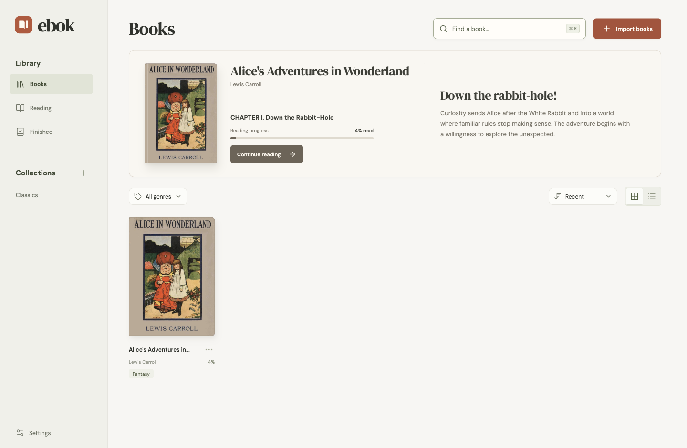

  

<h1 align="center">Ebok</h1>

Your books. Your quiet corner.

<strong>A local-first ebook reader with on-device AI word explanations.</strong>

Read on macOS, Windows, and Linux. Understand words in the context of your book.

  
  
  

  <a href="#ai-that-understands-the-context">Explore the AI</a> ·
  <a href="#download">Download</a> ·
  <a href="docs/INSTALLATION.md">Installation guide</a> ·
  <a href="CHANGELOG.md">Release notes</a> ·
  <a href="https://github.com/xikiu/ebok-releases/issues/new/choose">Send feedback</a>

## AI that understands the context

An unfamiliar word can pull you out of a story. Ebok’s AI uses the selected word and its surrounding passage to offer a short explanation of what it means **in that sentence**, right beside the page.

**Built with Llama.** Powered by Meta’s [Llama 3.2 1B Instruct](https://huggingface.co/meta-llama/Llama-3.2-1B-Instruct), using 4-bit weights and [WebLLM](https://webllm.mlc.ai/) with WebGPU to run on your device.

- **Context-aware explanations.** Go beyond a word’s general dictionary meaning to understand how it is used in your book.
- **Local AI inference.** Your selected word and passage are processed on your computer, without being sent to a remote AI service.
- **Optional and in your control.** Select a word, choose **Define**, then **Enable AI**. Turn it off from the same popup whenever you like.

AI needs a compatible GPU and an initial **~700 MB download**. Once the required model files are cached, explanations can run offline. AI answers can be mistaken; the bundled dictionary remains available alongside them. [AI setup, privacy, and requirements](docs/AI.md).

*The Alice sample with the real AI opt-in panel, before the model download.*

## Download

**Current release: [Alpha](https://github.com/xikiu/ebok-releases/releases/tag/v0.1.0-alpha.2).** This is an early testing release. Keep copies of your original ebooks.

| Platform | Architecture | Installer |
| :--- | :--- | :--- |
| macOS | Apple Silicon (M-series) | [Download DMG](https://github.com/xikiu/ebok-releases/releases/download/v0.1.0-alpha.2/Ebok-Alpha-mac-arm64.dmg) |
| macOS | Intel | [Download DMG](https://github.com/xikiu/ebok-releases/releases/download/v0.1.0-alpha.2/Ebok-Alpha-mac-x64.dmg) |
| Windows | x64 | [Download installer](https://github.com/xikiu/ebok-releases/releases/download/v0.1.0-alpha.2/Ebok-Alpha-win-x64.exe) |
| Linux | x64 | [Download AppImage](https://github.com/xikiu/ebok-releases/releases/download/v0.1.0-alpha.2/Ebok-Alpha-linux-x64.AppImage) |

Mac builds are not notarized; Windows installers are unsigned. See the [installation guide](docs/INSTALLATION.md) for first-launch instructions, manual updates, and checksum verification.

## A place for your reading

- **Bring your own books.** Import EPUB, PDF, Kindle/Mobipocket, FictionBook, comics, and more with drag and drop.
- **Make a library that feels like yours.** Create collections, save favorites, and pick up where you left off.
- **Settle into the page.** Adjust typography, page color, and reading flow; save bookmarks, highlights, and notes.
- **Keep learning as you read.** Pair AI word explanations with the bundled English dictionary and optional online translation.

Your library is stored on your computer, and ordinary reading works offline. There is no account or cloud-sync service. Optional online lookup and translation need internet; local AI needs a compatible GPU and an initial model download.

## Try it with a classic

[Download Alice’s Adventures in Wonderland (EPUB)](https://github.com/xikiu/ebok-releases/releases/download/v0.1.0-alpha.2/alice-in-wonderland.epub), by Lewis Carroll, then choose **Import books** or drop the file into Ebok.

[Project Gutenberg](https://www.gutenberg.org/ebooks/11) lists this book as public domain in the USA. The sample retains its original credits and full license. All screenshots above use this same sample. [Sample details](samples/README.md).

## Before you start

Imports are limited to **100 MB per file**. DRM-protected ebooks, KFX, ACSM, legacy DOC, and password-protected PDFs are unsupported. PDF and comic text search and OCR are unavailable. Extra legacy formats require a separate Calibre installation. See [supported formats and alpha limitations](docs/FORMATS.md).

Updates are installed manually. Desktop and browser libraries are separate, and there is no cloud backup. Keep your original ebook files; deleting app data removes the local library.

## Help shape Ebok

Found something that gets in the way of reading? [Report a bug](https://github.com/xikiu/ebok-releases/issues/new?template=bug_report.yml). Have an idea? [Suggest a feature](https://github.com/xikiu/ebok-releases/issues/new?template=feature_request.yml).

For bugs, include your Ebok version, operating system, book format, and reproduction steps. Use the Alice sample or another small file you have permission to share.

---

This is Ebok’s public home for downloads, release notes, and feedback. The application source is maintained privately. Third-party component licenses are included in the app; optional AI-model weights retain their upstream terms.
